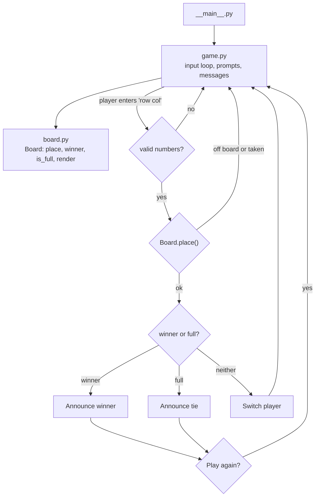

# Gridlock

Two-player tic-tac-toe for the terminal, with the rules engine kept separate from the input loop so it can be tested.

## Features

- Two players share the keyboard: player 1 is `X`, player 2 is `O`
- A random player opens each game
- Input validation: non-numeric entries, wrong counts, off-board cells and occupied cells are rejected with a message and the same player is asked again
- Win detection across all 8 lines (3 rows, 3 columns, 2 diagonals) and tie detection
- Rematch prompt with a running tally of wins and ties
- Ctrl+C or end of input exits cleanly

There is no computer opponent.

## Play

Requires Python 3.9 or newer. No third-party dependencies.

```bash
pip install -e .
gridlock                 # or: python -m gridlock
```

Moves are zero-based `row column` pairs, for example `1 2` is the middle row, right column.

```
Player 1 goes first.

- - -
- - -
- - -

Player 1 (X) - enter row and column (0-2): 1 1

- - -
- X -
- - -
```

## Architecture



`board.py` has no input or output. `game.py` takes the input function and random source as arguments, so tests drive whole games with scripted moves.

## Project structure

```
src/gridlock/
  board.py        rules: placement, win and tie detection, rendering
  game.py         terminal loop
  __main__.py     entry point
tests/
  test_board.py   every winning line, tie, illegal moves
  test_game.py    scripted games: wins, tie, bad input, rematch tally
.github/workflows/ci.yml
```

## Tests and lint

```bash
pip install -r requirements-dev.txt
pytest
ruff check .
```

## Limitations

- Local two-player only; no computer opponent or network play
- Fixed 3x3 board
- Plain-text interface with no colour or cell numbering
- The tally is kept only for the current session
- The tests are written but have not been run in CI yet

## Roadmap

- Computer opponent (for example minimax, which is solvable on a 3x3 board)
- Configurable board size
- Cell numbering or coordinates drawn around the board

## License

MIT. See [LICENSE](LICENSE).
